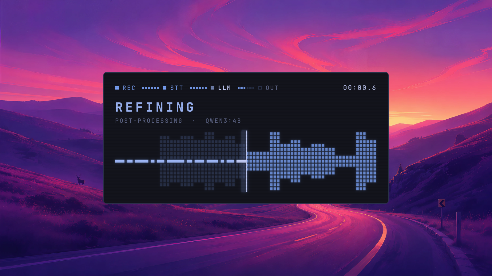

# Voxscope



A dictation HUD for [Voxtype](https://voxtype.io) on Omarchy, built as an
`omarchy-shell` plugin. It shows the whole dictation pipeline: the live
microphone spectrum while recording, a scan line over the recording while it
is transcribed, a second pass while an LLM cleans the text up, and the words
being typed, each paced to finish with the real work.

## What it does


A themed card appears in the middle of the focused screen while Voxtype is
recording or transcribing. A stepper across the top (REC, STT, LLM, OUT)
follows the pipeline, the line from each stage to the next a row of small
cells that light one by one as that stage progresses, and the middle shows
each stage in its own way:

- **Listening.** A mirrored live spectrum of the microphone with held peaks,
  and indicator lights for input, voice and clipping. Meanwhile the loudness
  is recorded as a timeline.
- **Transcribing.** The recording's timeline as a soft envelope, with a scan
  line sweeping across it and rebuilding it from square cells.
- **Refining.** A second scan line over those cells, turning them into blocks
  the length of the transcript's words, while an LLM cleans the text up.
- **Typing.** The words typed out as runs of cells behind a block cursor. The
  subtitle gives the word count and whether the LLM cleaned the text.

Neither speech to text nor the LLM reports progress, so each scan runs for an
estimated time that Voxscope learns from the dictations you make, and the
typing animation is paced to end when Voxtype's real typing does. When Voxtype
goes idle the card stays a moment longer to finish its animation, never more
than a second and a half, then fades out. It fades and scales in when it
appears.

The card takes the colours of the active Omarchy theme from its
`colors.toml`: everything is drawn in the theme's accent, warnings in its
`red`, the card in `dark_background` and the scan lanes in `selection`, and
light themes (`mode = "light"`) get stronger tints and no scanlines. The text
is in the system monospace font, the one `omarchy font set` chooses. The card
never takes keyboard focus and lets clicks through to whatever is underneath.

While recording it also counts down the last ten seconds before Voxtype's
recording cap (`audio.max_duration_secs`), and it can stop a recording after
ten seconds without voice (see below). A countdown shows in the subtitle and
empties the cells of the stepper's line after REC in the theme's red.

## Requirements

- Omarchy with `omarchy-shell` and its plugin system.
- Voxtype 1.0 or later, which provides the state file in
  `$XDG_RUNTIME_DIR/voxtype/` and `voxtype-audio-bridge`.

## Install

```
omarchy plugin add https://github.com/iryzhkov/omarchy-voxscope.git --enable
```

By hand, put a copy (or a clone) of this repository in
`~/.config/omarchy/plugins/io.github.iryzhkov.voxscope/`, then:

```
omarchy-shell shell rescanPlugins
omarchy plugin enable io.github.iryzhkov.voxscope
```

The plugin is a `panel` with `keepLoaded`, like Omarchy's own OSD: once
enabled, the shell loads it at startup and keeps it loaded. It has no key
binding and nothing to summon; it appears by itself when you dictate.

### Updating

`omarchy plugin update` (or a `git pull` in the plugin's directory) replaces
the files, but the running shell keeps the plugin it has already loaded, so
the old version stays on screen until the shell restarts:

```
omarchy restart shell
```

### Removing

```
omarchy plugin remove io.github.iryzhkov.voxscope
omarchy restart shell
```

Then turn Voxtype's own OSD back on (`voxtype config set osd.enabled true`,
see below) and restart Voxtype. Voxscope's learned timing and microphone
calibration stay in `~/.local/state/voxscope/`; delete that directory to
remove them too. Its other files live in `$XDG_RUNTIME_DIR/voxscope/` and
go away with the session. If you installed the example post-process script,
remove it and the `[output.post_process]` entry that points to it.

### Settings

Omarchy keeps plugin settings on the plugin's entry in
`~/.config/omarchy/shell.json`, the one `omarchy plugin enable` adds to
`plugins`. Voxscope reads three, all optional:

```json
{
  "id": "io.github.iryzhkov.voxscope",
  "compact": true,
  "position": "bottom",
  "reducedMotion": true
}
```

- `compact` (`true` or `false`, default `false`): only the stepper and the
  visualisation, without the title, subtitle and indicator lights. A
  countdown before an automatic stop shows in place of the clock.
- `position` (`"center"` or `"bottom"`, default `"center"`): the middle of
  the focused screen, or centred just above its bottom edge.
- `reducedMotion` (`true` or `false`, default `false`): every stage and scan
  is still shown, but without the bloom swelling with your voice, the
  scanlines, blinking, or the card scaling in; it only fades.

Any other value counts as the default. The shell reloads `shell.json` when
it changes, so a saved edit applies from the next dictation.

### Turn off Voxtype's own OSD

Voxtype draws its own on-screen display by default, which would sit on top of
Voxscope. Its master switch is `osd.enabled` in
`~/.config/voxtype/config.toml`:

```toml
[osd]
enabled = false
```

or, equivalently:

```
voxtype config set osd.enabled false
```

The setting takes effect when the Voxtype daemon restarts: restart it the
way it was started (Omarchy's Voxtype install runs it as a user service), or
log out and back in. With it off, Voxtype's OSD frontends exit at launch;
the daemon still writes its state file and serves its audio socket, which is
all Voxscope needs. To go back, set it to `true` again and disable the
plugin.

A recording started with `voxtype record start --no-osd` hides Voxscope too,
as it does Voxtype's own OSD: for the whole dictation, including the
transcription, and without the linger afterwards. Voxscope does not run the
audio bridge or cava for it.

### Optional: cava

Voxtype's audio bridge only carries the microphone's peak and RMS level, so
the spectrum comes from [cava](https://github.com/karlstav/cava), in the Arch
`extra` repository as `cava`. While recording, Voxscope asks PipeWire for the
default source with `pactl` (from `libpulse`), writes a cava config for it to
`$XDG_RUNTIME_DIR/voxscope/cava.conf` and runs `/usr/bin/cava`. Without cava,
or without `pactl`, the bars are synthesised from the bridge's RMS level
instead, and nothing else changes. The plugin never installs anything.

cava runs at a fixed gain, and Voxscope scales each band to how loud your
speech has been in it lately, so soft and loud speech both fill a good part
of the height without loud speech sitting at the top, while the room's hiss
stays at the resting centre cell. Each recording starts from what the last
one learned, capped so that soft speech moves at once; the first syllable
of loud speech may briefly reach the top while it catches up.

The gain is cava's `sensitivity = 3000` with `autosens` off, in
[`cava.conf`](cava.conf), whose comments give the measurement it comes
from: through a MacBook Air microphone at cava's usual sensitivity of 300,
normal speech peaked at about 40 of cava's 1000 steps and soft speech at
about 10, too coarse to draw; at 3000 they peak around 250 to 700 and 60 to
390. A microphone much louder or quieter than that still works, because the
scaling adapts, but a different gain can be set there.

### Optional: the post-process script

Voxtype reports one `transcribing` state for both speech to text and its
post-process command, so on its own Voxscope cannot tell them apart: it shows
one scan until Voxtype is done. A post-process script that reports its stages
lets it show speech to text, the LLM cleanup and the typing separately, with
the word count and whether the text was cleaned.

`examples/voxtype-clean` is such a script. It collapses Whisper's line breaks
and, when an [Ollama](https://ollama.com) server has the cleanup model loaded,
asks it to fix punctuation and remove filler words, falling back to the plain
text on any failure. To use it, copy it somewhere on your path, make it
executable, and point Voxtype at it in `~/.config/voxtype/config.toml`:

```toml
[output.post_process]
command = "/home/you/.local/bin/voxtype-clean"
timeout_ms = 8000
```

It reads its settings from the environment of the Voxtype daemon:
`VOXTYPE_CLEAN_BASE` (the Ollama URL, default `http://localhost:11434`),
`VOXTYPE_CLEAN_MODEL` (default `qwen3:4b`; a comma-separated list picks the
first one installed), `VOXTYPE_CLEAN_SAME_WEIGHTS` (other model names built
from the same weights, such as a variant with a different template; Ollama
serves them from one loaded copy, so one of them being loaded counts as the
model being loaded), `VOXTYPE_CLEAN_TIMEOUT` (seconds, default 5) and
`VOXTYPE_CLEAN_LLM=0` to skip the LLM.

To report stages from a script of your own, see
[docs/postprocess-protocol.md](docs/postprocess-protocol.md).

### Optional: silence auto-stop

A push-to-talk recording ends when you release the key, but a toggled one runs
until you press again. Voxscope stops a toggled recording itself after ten
seconds without voice, counting down for the last five, by running
`voxtype record stop`. It only does this for recordings it knows were
toggled: the toggle binding has to stamp the time, in milliseconds, into
`$XDG_RUNTIME_DIR/voxtype/toggle-start` just before starting. For example,
bind your toggle key to a script like this instead of `voxtype record toggle`:

```bash
#!/bin/bash
dir="${XDG_RUNTIME_DIR:-/run/user/$(id -u)}/voxtype"
if [ "$(cat "$dir/state" 2>/dev/null)" = idle ]; then
  date +%s%3N > "$dir/toggle-start"
fi
exec voxtype record toggle
```

"Voice" here is the `vad` flag of Voxtype's audio bridge. In Voxtype 1.0.1
the bridge computes it itself, as the frame's peak level being above
-40 dBFS (`src/bin/voxtype_audio_bridge.rs`); it does not come from
Voxtype's own voice activity detection, so it is set whether or not the
`[vad]` section of Voxtype's configuration is enabled. It is a loudness
threshold rather than speech detection, so a noisy room can keep a
recording from stopping, but never stops one early. Silence is counted only
while bridge frames are arriving: if the bridge is missing, has not
connected or is restarting, no countdown runs and the recording is left to
you.

## Files

Voxscope keeps what it learns in `$XDG_STATE_HOME/voxscope/`
(`~/.local/state/voxscope/`), created on first start with mode 700:
`timing.json` holds the learned speeds of speech to text, the LLM and
typing, and `calibration.json` the spectrum's per-band levels for your
microphone and room (`spectrum.js` describes them). Deleting them starts the
learning over. The generated cava config goes to
`$XDG_RUNTIME_DIR/voxscope/cava.conf`. Nothing is ever written to the
plugin's own directory.

## What it runs and reads

Voxscope runs four programs, each by absolute path, with a cleared
environment (only `PATH=/usr/bin`, `LC_ALL=C`, `HOME`, `XDG_RUNTIME_DIR`, and
`XDG_CONFIG_HOME`, `PIPEWIRE_RUNTIME_DIR` and `PULSE_SERVER` when the session
sets them) and a deadline:

- `/usr/bin/voxtype-audio-bridge` and `/usr/bin/cava`, only while it shows a
  recording, stopped when the recording ends, when the shell exits or dies,
  and in any case a minute after Voxtype's recording cap;
- `/usr/bin/pactl get-default-source` once per recording, and
  `/usr/bin/voxtype record stop` for the silence auto-stop;
- `/usr/bin/install -d -m 700` once at startup, which makes the directories
  above and keeps them private to you.

It reads Voxtype's state, `osd_suppressed`, `toggle-start` and
`postprocess.json` in `$XDG_RUNTIME_DIR/voxtype/`, Voxtype's `config.toml`,
the theme's `colors.toml`, its own two files and its cava template, each
through a helper that refuses anything but a regular file of yours and stops
at a byte cap (from 32 bytes for the toggle stamp to 256 KiB for Voxtype's
configuration). Every value read is range-checked or matched against the
values it may take before it is used, and nothing it reads is ever run as a
command. `Helper.js` and `Sanitize.js` hold the details, and the tests check
them.

## Development

`scripts/lint` runs qmllint over the QML and checks the syntax of the shell,
Python and JavaScript files; `scripts/test` runs the unit tests headless
(Qt Quick Test for the pure JavaScript and `Card.qml`, Node for the command
lines `Helper.js` builds, executed for real). Both need Qt 6's declarative
tools and Node; CI runs them on every push
(`.github/workflows/checks.yml`).

`tests/harness/run.sh <scenario>` runs the HUD in a standalone Quickshell
against a scratch directory under `~/.cache/voxscope-test/`, plays a scripted
dictation into it and saves frames of the card; see the script for the
scenarios, among them `quiet` and `loud`, which feed the spectrum from a fake
cava. It needs a running Wayland session, so it is not part of CI.
`tests/harness/sheet.sh <dir>` makes a contact sheet of the pipeline across
stock themes and settings, and `tests/harness/capture.sh` remakes
`preview.png` and `demo.gif` on Tokyo Night and one of its own wallpapers,
without touching the active theme. `timing.js` holds the timing model and
`spectrum.js` the spectrum's calibration, both as pure functions.

## Credits

`VoxtypeState.qml` and `VoxtypeAudio.qml` are adapted from Voxtype's
Quickshell frontend, MIT licence, copyright (c) 2025 Peter Jackson.

## Licence

MIT; see [LICENSE](LICENSE).
